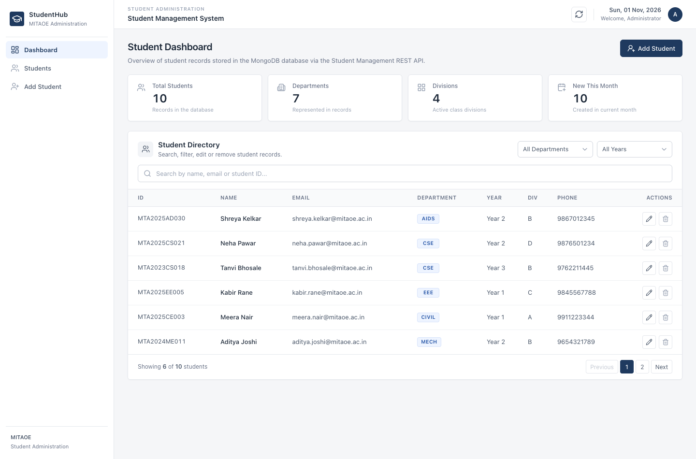
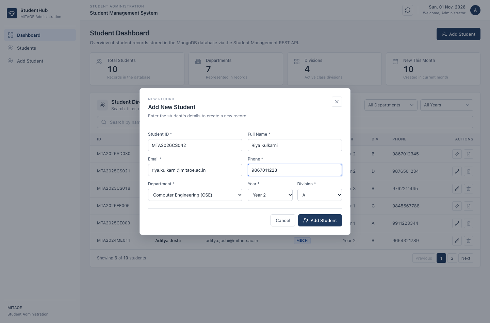
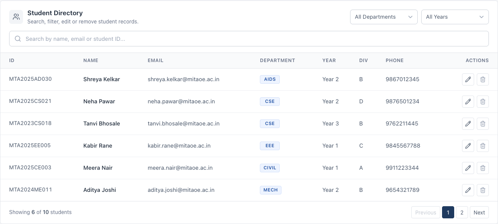
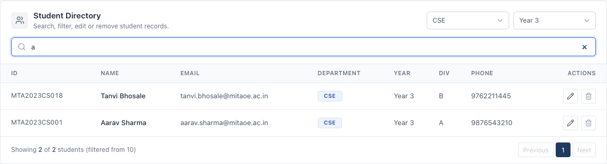
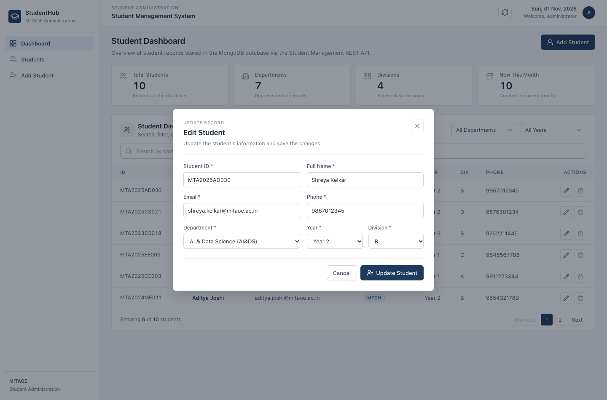
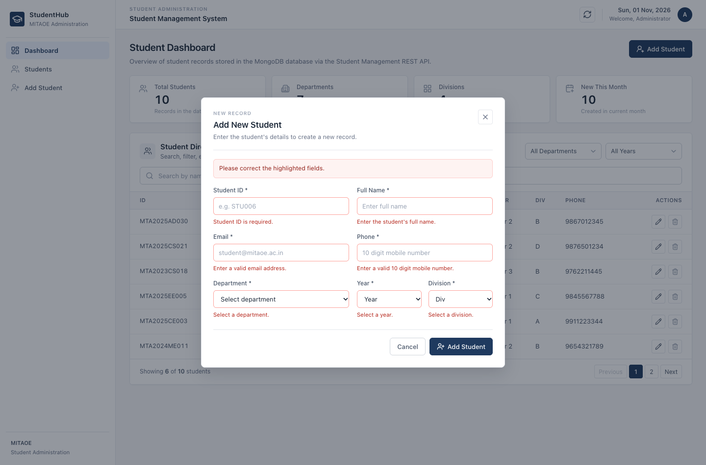
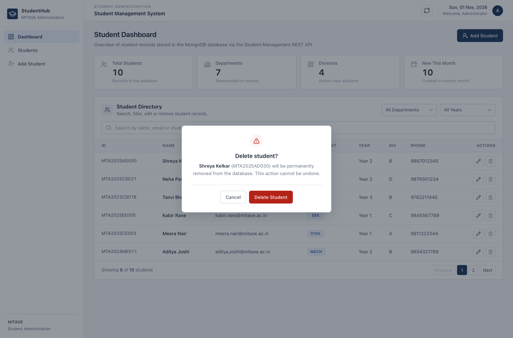

# 🎓 Student Management REST API

A database-backed Student Management System built with the **MERN stack** for **MITAOE Web Technology – Practical No. 06**.

The project exposes a complete **RESTful CRUD API** for student records, with a React administration dashboard that performs every operation through the API. Data is stored in **MongoDB** through Mongoose; no in-memory arrays are used.

> **Verification status:** all CRUD endpoints, validation rules, database persistence and Postman tests were executed locally against a real MongoDB instance. See [Testing results](#-testing-results). The application has **not** been deployed to a public URL from this codebase yet — the [deployment guide](#-deployment) covers the steps.

---

## 📌 Project Overview

| Item | Details |
| --- | --- |
| Project | Student Management System |
| Practical | MITAOE Web Technology – Practical No. 06 |
| Type | Full-stack REST API with admin dashboard |
| Frontend | React 19 + Vite |
| Backend | Node.js + Express 5 |
| Database | MongoDB (Atlas or local) via Mongoose |
| API style | REST + JSON |

---

## ✨ Features

### REST API
- Full CRUD: create, list, read by id, update, delete.
- Correct status codes: `200`, `201`, `400`, `404`, `500`.
- Field-level validation with readable error messages.
- Unique Student ID **and** unique email.
- Email format and Indian mobile number validation.
- Centralized error handling and JSON 404s for unknown routes.
- Optional server-side `search`, `department` and `year` query filters.
- Health endpoint for hosting platforms and readiness checks.
- CORS allowlist driven by an environment variable.

### Dashboard
- Overview cards: total students, departments, divisions, new this month.
- Searchable student table (name, email or Student ID).
- Filter by department and by year (combinable).
- Add and edit students in a validated form.
- Delete with an explicit confirmation dialog.
- Success and error notifications.
- Responsive layout for laptop, tablet and mobile widths.

---

## 🛠️ Technology Stack

| Layer | Technology |
| --- | --- |
| Frontend | React 19, Vite 8, Axios, Lucide React, CSS |
| Backend | Node.js (≥ 18), Express 5, Mongoose 9, CORS, dotenv |
| Database | MongoDB / MongoDB Atlas |
| API testing | Postman collection + Newman |
| Deployment target | Render (backend web service + static frontend) |

---

## 📁 Project Structure

```text
student-management-system/
│
├── client/                          # React + Vite dashboard
│   ├── src/
│   │   ├── api/
│   │   │   └── studentsApi.js       # Axios client + error helper
│   │   ├── components/
│   │   │   ├── ConfirmDialog.jsx    # Delete confirmation
│   │   │   ├── Sidebar.jsx
│   │   │   ├── StatCard.jsx
│   │   │   ├── StudentDirectory.jsx # Search, filters, table, pagination
│   │   │   ├── StudentForm.jsx      # Add / edit form with validation
│   │   │   └── Toast.jsx            # Success / error notifications
│   │   ├── constants/
│   │   │   └── departments.js       # Departments, years, divisions
│   │   ├── App.jsx                  # Dashboard state and API calls
│   │   ├── index.css
│   │   └── main.jsx
│   ├── .env.example
│   ├── index.html
│   ├── package.json
│   └── vite.config.js               # Dev proxy /api -> localhost:5001
│
├── server/                          # Express REST API
│   ├── config/
│   │   └── db.js                    # MongoDB connection
│   ├── controllers/
│   │   └── studentController.js     # CRUD business logic
│   ├── middleware/
│   │   ├── errorHandler.js          # Central error handler + 404
│   │   └── validateStudent.js       # Body/param validation
│   ├── models/
│   │   └── Student.js               # Mongoose schema + validation
│   ├── routes/
│   │   └── studentRoutes.js         # /api/students routes
│   ├── utils/
│   │   └── ApiError.js              # HTTP-aware error type
│   ├── .env.example
│   ├── app.js                       # Express app configuration
│   ├── server.js                    # Bootstraps DB + HTTP server
│   └── package.json
│
├── postman/
│   ├── MITAOE_Practical_06_Student_Management_API.postman_collection.json
│   ├── MITAOE_Practical_06_Local.postman_environment.json
│   └── MITAOE_Practical_06_Deployed.postman_environment.json
│
├── docs/
│   └── MITAOE_Practical_06_Report.md   # Practical report (12 sections)
│
├── screenshots/                     # Captured from the running application
├── .gitignore
├── package.json                     # Convenience scripts only
└── README.md
```

---

## ⚙️ Installation

Requirements: **Node.js 18+**, **npm**, and a MongoDB database (local `mongod` or MongoDB Atlas).

```bash
git clone <your-repository-url>
cd student-management-system
npm run install:all      # installs server and client dependencies
```

`npm run install:all` is a shortcut for:

```bash
npm install --prefix server
npm install --prefix client
```

---

## 🔐 Environment Variables

Environment files are **not** committed. `.gitignore` excludes `.env` everywhere while keeping the example files.

### Backend — `server/.env`

Copy `server/.env.example` to `server/.env`:

| Variable | Required | Description |
| --- | --- | --- |
| `MONGO_URI` | ✅ | MongoDB connection string (local or Atlas) |
| `PORT` | optional | HTTP port, defaults to `5001`. Render injects its own port automatically. |
| `NODE_ENV` | optional | `development` or `production` |
| `CLIENT_ORIGIN` | recommended | Comma-separated allowed browser origins, e.g. `http://localhost:5173,https://your-frontend.onrender.com`. Empty means "allow any origin" (development only). |
| `HOST` | optional | Bind address, defaults to `0.0.0.0` |

```env
MONGO_URI=mongodb://127.0.0.1:27017/student_management
PORT=5001
NODE_ENV=development
CLIENT_ORIGIN=http://localhost:5173
```

### Frontend — `client/.env`

| Variable | Description |
| --- | --- |
| `VITE_API_URL` | Public API base URL **including** `/api`. Leave empty in development; Vite proxies `/api` to `http://localhost:5001`. |

```env
# production only
VITE_API_URL=https://your-api-service.onrender.com/api
```

> Port note: the API defaults to **5001** because macOS reserves port 5000 for the AirPlay Receiver. `.env.example`, the Vite proxy and the docs all use 5001.

---

## 🗄️ Database Configuration

### Option A — Local MongoDB

```bash
mkdir -p .mongodb-data
mongod --dbpath ./.mongodb-data --port 27017
```

Connection string: `mongodb://127.0.0.1:27017/student_management`

### Option B — MongoDB Atlas (used in production)

1. Create a free cluster at <https://www.mongodb.com/atlas>.
2. Create a database user and allow network access (`0.0.0.0/0` for Render, or Render's egress IPs).
3. Copy the connection string, add the database name, and set it as `MONGO_URI`:

```text
mongodb+srv://<user>:<password>@<cluster>.mongodb.net/student_management?retryWrites=true&w=majority
```

### Student schema

| Field | Type | Rules |
| --- | --- | --- |
| `studentId` | String | required, unique, 3–20 letters/numbers/hyphens, stored uppercase |
| `name` | String | required, 2–80 characters |
| `email` | String | required, unique, lowercase, valid email format |
| `phone` | String | required, 10 digit Indian mobile number (`+91` optional) |
| `department` | String | required, one of `CSE, IT, AIDS, ECE, EEE, MECH, CIVIL` |
| `year` | Number | required, integer 1–4 |
| `division` | String | required, single letter (e.g. `A`) |
| `createdAt` / `updatedAt` | Date | generated automatically (Mongoose timestamps) |

Indexes: unique on `studentId`, unique on `email`, descending on `createdAt`.

---

## ▶️ Local Execution

Use two terminals.

**Terminal 1 — API**

```bash
cd server
npm start          # or: npm run dev (nodemon)
```

```text
MongoDB connected: 127.0.0.1/student_management
Server running on http://localhost:5001
```

**Terminal 2 — Frontend**

```bash
cd client
npm run dev
```

Open <http://localhost:5173>. The dashboard loads records through `GET /api/students`; every add, edit and delete writes to MongoDB.

Root shortcuts:

```bash
npm run server     # start API
npm run client     # start dashboard
npm run build      # production build of the dashboard
```

---

## 🔗 REST API Documentation

**Base URL**

```text
Local:      http://localhost:5001/api
Production: https://<your-api-service>.onrender.com/api
```

| Method | Endpoint | Description | Success |
| --- | --- | --- | --- |
| GET | `/health` | Service and database health | `200` |
| GET | `/students` | List students (supports `?search=&department=&year=`) | `200` |
| GET | `/students/:id` | Get one student by MongoDB id | `200` |
| POST | `/students` | Create a student | `201` |
| PUT | `/students/:id` | Update a student (full or partial) | `200` |
| DELETE | `/students/:id` | Delete a student | `200` |
| GET | `/students/meta` | Supported departments and years | `200` |

### Status codes

| Code | Meaning in this API |
| --- | --- |
| `200` | Request succeeded (read, update, delete) |
| `201` | Student created |
| `400` | Validation failed, duplicate Student ID/email, invalid id, malformed JSON |
| `403` | Browser origin not in `CLIENT_ORIGIN` |
| `404` | Student or route not found |
| `500` | Unexpected server/database error |

### Response shapes

Success:

```json
{
  "success": true,
  "message": "Student created successfully",
  "data": { "...": "student document" }
}
```

Error:

```json
{
  "success": false,
  "message": "Validation failed",
  "errors": [{ "field": "email", "message": "Email format is invalid" }]
}
```

### Sample requests and responses

#### 1. Create a student

```bash
curl -X POST http://localhost:5001/api/students \
  -H "Content-Type: application/json" \
  -d '{
    "studentId": "MTA2023CS001",
    "name": "Aarav Patil",
    "email": "aarav.patil@mitaoe.ac.in",
    "phone": "9876543210",
    "department": "CSE",
    "year": 3,
    "division": "A"
  }'
```

`201 Created`

```json
{
  "success": true,
  "message": "Student created successfully",
  "data": {
    "_id": "672f1c2b8e1a4d4f9c0a12ab",
    "studentId": "MTA2023CS001",
    "name": "Aarav Patil",
    "email": "aarav.patil@mitaoe.ac.in",
    "phone": "9876543210",
    "department": "CSE",
    "year": 3,
    "division": "A",
    "createdAt": "2026-11-01T10:12:31.004Z",
    "updatedAt": "2026-11-01T10:12:31.004Z"
  }
}
```

#### 2. Get all students

```bash
curl http://localhost:5001/api/students
curl "http://localhost:5001/api/students?department=CSE&year=3&search=aarav"
```

`200 OK`

```json
{
  "success": true,
  "count": 1,
  "data": [{ "_id": "672f1c2b8e1a4d4f9c0a12ab", "studentId": "MTA2023CS001", "...": "..." }]
}
```

#### 3. Get one student

```bash
curl http://localhost:5001/api/students/672f1c2b8e1a4d4f9c0a12ab
```

`200 OK` → `{ "success": true, "data": { ... } }`

Unknown id → `404 Not Found`:

```json
{ "success": false, "message": "Student with id '672f...' not found" }
```

Malformed id → `400 Bad Request`:

```json
{
  "success": false,
  "message": "'not-an-id' is not a valid student id",
  "errors": [{ "field": "id", "message": "Must be a 24 character MongoDB ObjectId" }]
}
```

#### 4. Update a student

```bash
curl -X PUT http://localhost:5001/api/students/672f1c2b8e1a4d4f9c0a12ab \
  -H "Content-Type: application/json" \
  -d '{ "name": "Aarav S Patil", "email": "aarav.patil@mitaoe.ac.in", "phone": "9876501234", "department": "IT", "year": 4, "division": "B" }'
```

`200 OK` → `{ "success": true, "message": "Student updated successfully", "data": { ... } }`

#### 5. Delete a student

```bash
curl -X DELETE http://localhost:5001/api/students/672f1c2b8e1a4d4f9c0a12ab
```

`200 OK`

```json
{
  "success": true,
  "message": "Student deleted successfully",
  "data": { "_id": "672f1c2b8e1a4d4f9c0a12ab", "studentId": "MTA2023CS001", "...": "..." }
}
```

Deleting again, or fetching the deleted id, returns `404`.

#### 6. Validation and duplicate handling

Missing fields or an invalid email returns `400` with per-field details:

```json
{
  "success": false,
  "message": "Validation failed",
  "errors": [
    { "field": "email", "message": "Email format is invalid" },
    { "field": "phone", "message": "Phone must be a valid 10 digit Indian mobile number" }
  ]
}
```

Reusing an email or Student ID returns `400`:

```json
{ "success": false, "message": "A student with this email already exists", "errors": [{ "field": "email", "message": "A student with this email already exists" }] }
```

---

## 🧪 Postman Testing

Collection: `postman/MITAOE_Practical_06_Student_Management_API.postman_collection.json`

Environments:
- `MITAOE_Practical_06_Local.postman_environment.json` → `baseUrl = http://localhost:5001/api`
- `MITAOE_Practical_06_Deployed.postman_environment.json` → replace the placeholder with your public API URL.

### In the Postman app

1. **Import** the collection and both environment files.
2. Select the **Local** environment from the environment selector.
3. Run the requests **in order** (or use *Run collection*).

### Requests

| # | Request | Expected result |
| --- | --- | --- |
| 0 | API Health Check | `200`, database connected |
| 1 | Create Student | `201`, returns the created document, saves its id |
| 2 | Get All Students | `200`, array contains the new student |
| 3 | Get Student by ID | `200`, matches created data |
| 4 | Update Student | `200`, updated values returned |
| 5 | Delete Student | `200`, deleted document returned |
| 6 | Verify Deleted Student Returns 404 | `404`, descriptive message |
| 7 | Verify Invalid Input Handling | `400`, field errors, no record created |
| 8a | Setup student for duplicate test | `201` baseline record |
| 8b | Verify Duplicate Email Handling | `400`, "already exists" |
| 9 | Cleanup test data | `200`, database left clean |

Requests 1 and 8a generate a unique Student ID/email on every run, so the collection is repeatable and leaves no test records behind.

### With the URL, without clicking

```bash
npm install -g newman
newman run postman/MITAOE_Practical_06_Student_Management_API.postman_collection.json \
  -e postman/MITAOE_Practical_06_Local.postman_environment.json
```

Against the deployed API, copy the Deployed environment, set `baseUrl`, and pass it to `-e`.

---

## ✅ Testing Results

Executed on this machine, against a local MongoDB database and the running API.

**Endpoint and validation checks (curl):** 19 / 19 passed — create `201`, list/read `200`, invalid id `400`, unknown id `404`, missing fields `400`, bad email `400`, bad department `400`, duplicate email `400`, duplicate Student ID `400`, update `200`, invalid update `400`, update unknown id `404`, delete `200`, deleted read `404`, delete again `404`, health `200`, unknown route `404`, malformed JSON `400`.

**Persistence:** eight records were created through the API, the server process was stopped and restarted, and all eight records were returned from MongoDB afterwards.

**Postman collection via Newman:**

```text
requests     13 executed, 0 failed
assertions   35 executed, 0 failed
```

**Frontend:** verified in a real browser — records render from the API, live search and combined department/year filters narrow the table, add/update/delete all hit the API, duplicate email shows the backend message inside the form, and the delete confirmation removes the record from MongoDB. No console errors.

---

## 📸 Screenshots

Captured from the running application.

### Dashboard



### Add Student



### Student Directory



### Search and Filters



### Edit Student



### Form Validation



### Delete Confirmation



---

## 🚀 Deployment

The project is prepared for **Render** (the platform this repository already targeted): the API is a Node web service, the dashboard is a static site, and MongoDB Atlas provides the database.

### 1. MongoDB Atlas

Create the cluster and database user, allow Render's connections, and note the connection string. Add the database name before the `?` options.

### 2. Backend on Render

- **New → Web Service**, connect the repository.
- **Root Directory:** `server`
- **Build Command:** `npm install`
- **Start Command:** `npm start`
- **Environment variables:**

```text
MONGO_URI     = mongodb+srv://.../student_management?retryWrites=true&w=majority
NODE_ENV      = production
CLIENT_ORIGIN = https://<your-frontend>.onrender.com
```

`server.js` listens on `process.env.PORT` (assigned by Render) and binds `0.0.0.0`, so no port configuration is needed. Do **not** set `PORT` manually.

### 3. Frontend on Render

- **New → Static Site**, same repository.
- **Root Directory:** `client`
- **Build Command:** `npm install && npm run build`
- **Publish Directory:** `dist`
- **Environment variable:**

```text
VITE_API_URL = https://<your-api-service>.onrender.com/api
```

- **Rewrite rule:** `/*` → `/index.html` (single-page app).

### 4. Verify

```bash
curl https://<your-api-service>.onrender.com/api/health
```

Then run the Postman collection with the **Deployed** environment, and open the frontend URL to confirm the dashboard loads data from the public API.

> **What is and is not done:** the code, scripts and configuration needed for deployment are in place, but no deployment was performed or verified as part of this work. Do not present a URL as "tested" until the steps above have been run and the health endpoint plus Postman collection succeed against that URL.

---

## 🧭 Known Limitations and Next Steps

- No authentication: the API and dashboard are open. Add sign-in and per-user authorization before using real student data.
- No rate limiting, request logging or automated test suite beyond the Postman collection.
- Pagination is client-side; move it to the API when the dataset grows.
- Records created with the previous schema (`course` instead of `department`) are not migrated. If you have old data, map `course` → `department` and add a `division` before reusing the database.

---

## 📚 Learning Outcomes

REST resource design and status codes · Express routing, controllers and middleware · Mongoose schema design, indexes and validation · async/await error handling · environment-based configuration and CORS · React forms and state management · API integration with Axios · Postman collection automation · deployment preparation.

---

## 📄 Practical Report

A ready-to-submit report structure for MITAOE Practical No. 06 is in [docs/MITAOE_Practical_06_Report.md](docs/MITAOE_Practical_06_Report.md).

---

## 📜 License

Developed for educational purposes as part of the MITAOE Web Technology practical.
