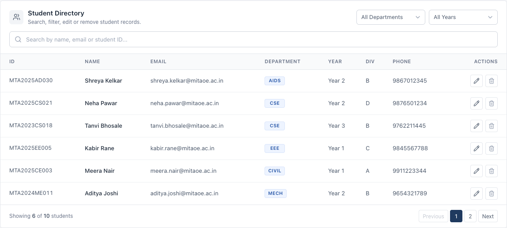
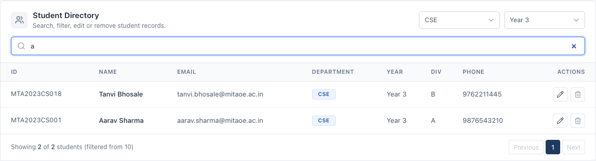
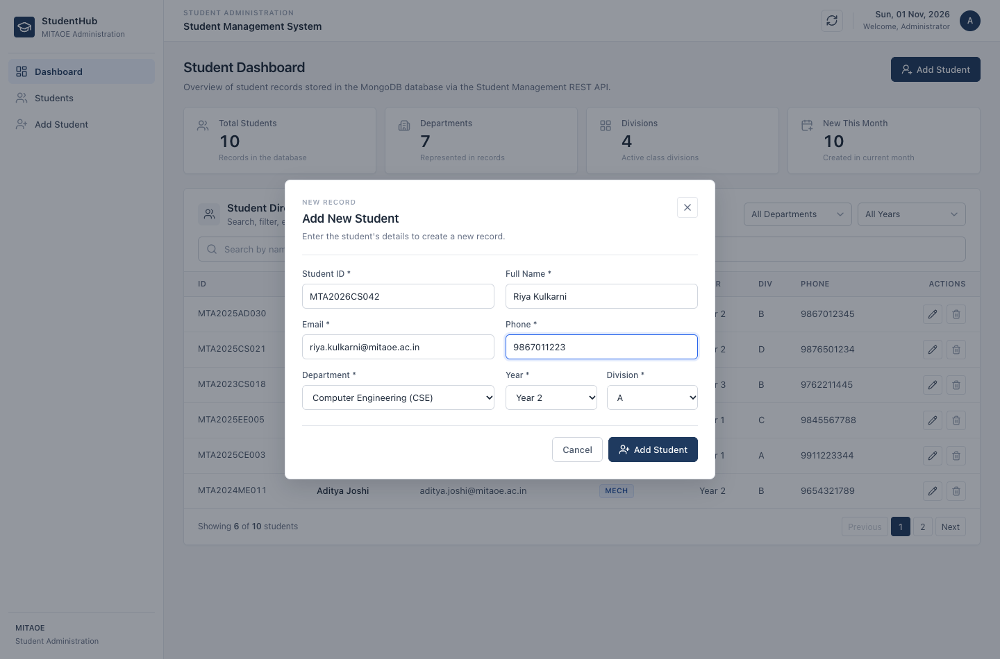
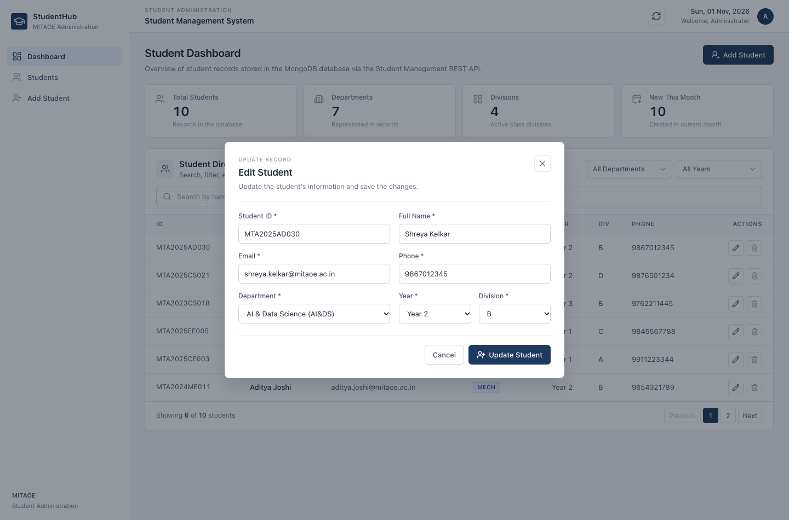
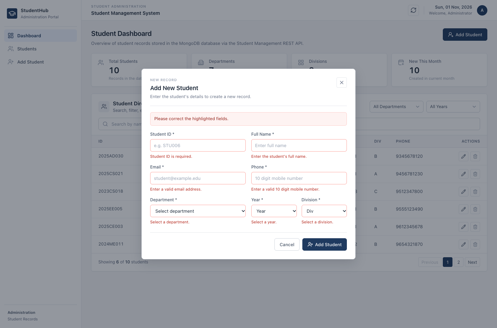
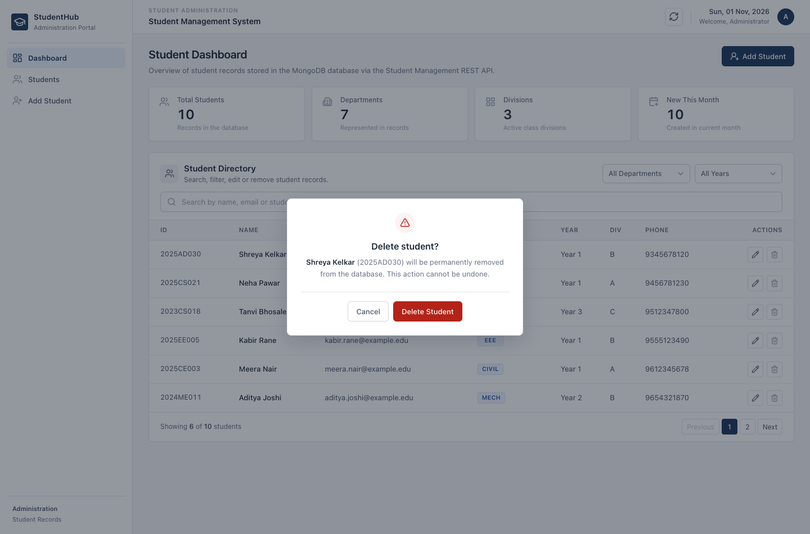
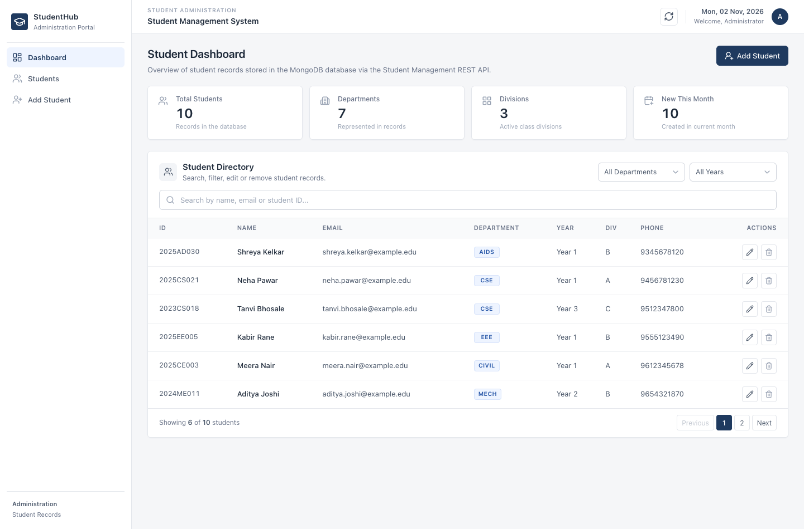
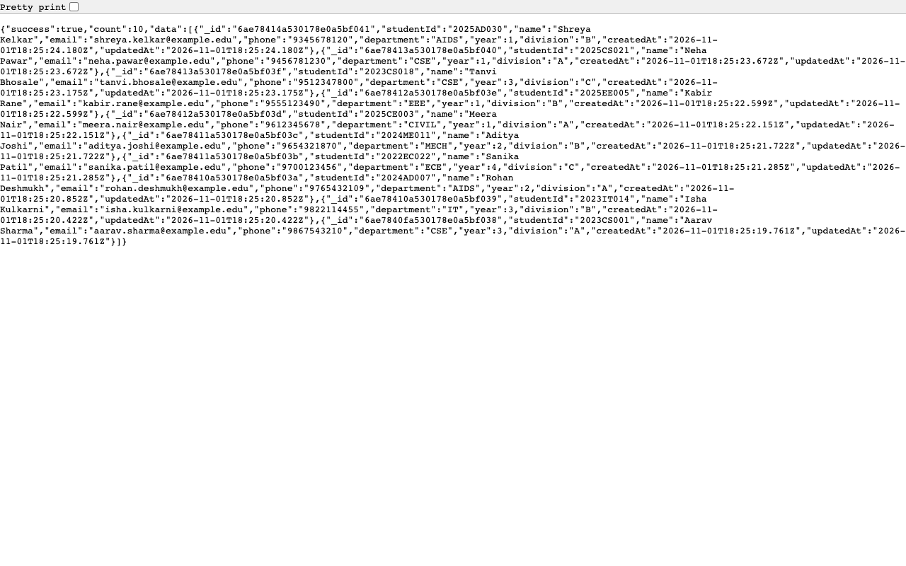
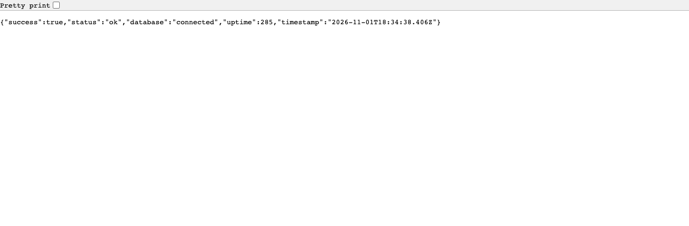

# MITAOE · Web Technology

## Practical No. 06 — Student Management REST API

**Practical report and test evidence**

---

### Submission details

| Field | Details |
| --- | --- |
| **Name** | Anvith Shetty |
| **PRN** | ______________________ |
| **Class / Division** | ______________________ |
| **Subject** | Web Technology (2310362L26-27) |
| **Practical No.** | 06 — RESTful API |
| **Title** | Design and implementation of a database-connected Student Management REST API with complete CRUD operations, tested with Postman and deployed publicly |
| **Date of Submission** | 02 November 2026 |
| **GitHub repository** | https://github.com/QuantumGod007/student-management-system |
| **Deployed API (public)** | https://student-management-api-anvith320-gmailcoms-projects.vercel.app/api |
| **Deployed dashboard (public)** | https://student-management-dashboard-anvith320-gmailcoms-projects.vercel.app |
| **Postman collection** | `postman/MITAOE_Practical_06_Student_Management_API.postman_collection.json` |
| **Live health check** | https://student-management-api-anvith320-gmailcoms-projects.vercel.app/api/health |

> **Fill in before uploading:** PRN, class/division, and the Postman GUI screenshots listed in
> [Appendix D](#appendix-d--submission-checklist). Everything else in this report is already
> populated with measured results from the running application and the public deployment.

---

## Index

| Section | Page topic |
| --- | --- |
| [1. Aim](#1-aim) | Aim of the practical |
| [2. Objectives](#2-objectives) | Learning objectives |
| [3. Technologies Used](#3-technologies-used) | Stack and tooling |
| [4. Introduction to RESTful APIs](#4-introduction-to-restful-apis) | REST concepts, methods, status codes |
| [5. System Architecture](#5-system-architecture) | Components and request lifecycle |
| [6. Database Design](#6-database-design) | Schema, indexes, sample document |
| [7. API Endpoint Documentation](#7-api-endpoint-documentation) | Endpoints, payloads, responses |
| [8. Implementation](#8-implementation) | Backend, validation, errors, frontend |
| [9. Postman Testing Results](#9-postman-testing-results) | Collection, assertions, screenshots |
| [10. Deployment Details](#10-deployment-details) | Vercel + Atlas configuration and verification |
| [11. Result](#11-result) | Outcome of the practical |
| [12. Conclusion](#12-conclusion) | Learning outcomes |
| [Appendix A](#appendix-a--project-structure) | Project structure |
| [Appendix B](#appendix-b--environment-variables) | Environment variables |
| [Appendix C](#appendix-c--commands-used) | Commands used |
| [Appendix D](#appendix-d--submission-checklist) | Submission checklist |

---

## 1. Aim

To design, implement, test and deploy a **database-connected RESTful API** for managing student
records, supporting **Create, Read, Update and Delete (CRUD)** operations over HTTP, and to verify
every endpoint using **Postman** — both against a local instance and against the **public deployed
URL**.

---

## 2. Objectives

1. Understand REST principles and expose the `student` resource through resource-oriented URLs.
2. Connect an Express application to a persistent **MongoDB** database using Mongoose.
3. Implement all five CRUD endpoints with the correct HTTP methods and status codes.
4. Design a validated schema that rejects invalid, incomplete and duplicate data.
5. Organise the backend into routes, controllers, models and middleware with **centralized error handling**.
6. Build a React administration dashboard that performs every operation through the API.
7. Write a reusable **Postman collection** covering success cases, validation failures and `404` cases.
8. Deploy the API and frontend publicly, and repeat the Postman tests against the deployed API.

---

## 3. Technologies Used

| Component | Technology | Purpose |
| --- | --- | --- |
| Runtime | Node.js 18+ | Server-side JavaScript |
| Backend framework | Express 5 | Routing, middleware, HTTP handling |
| Database | MongoDB Atlas (production), MongoDB local (development) | Persistent document storage |
| ODM | Mongoose 9 | Schema, validation, queries, indexes |
| Configuration | dotenv + environment variables | Secrets and per-environment settings |
| CORS | `cors` package | Restrict browser access to the dashboard origin |
| Frontend | React 19 + Vite | Administration dashboard |
| HTTP client | Axios | Dashboard → API communication |
| Icons | Lucide React | Interface icons |
| API testing | Postman + Newman (Postman CLI) | Manual and automated endpoint verification |
| Hosting | Vercel (API Function + static frontend) | Public deployment |
| Version control | Git + GitHub | Source hosting and history |

**Source code:** https://github.com/QuantumGod007/student-management-system

---

## 4. Introduction to RESTful APIs

**REST (Representational State Transfer)** is an architectural style in which the server exposes
*resources* as URLs, and clients manipulate those resources with standard HTTP methods. Every
request is **stateless** — each one carries all the information needed to process it.

In this practical the resource is a **student**, so the URL is a noun (`/api/students`) rather than
a verb (`/getStudents`).

| HTTP method | Semantics | Endpoint in this practical |
| --- | --- | --- |
| `GET` | Read a collection or a single resource | `GET /api/students`, `GET /api/students/:id` |
| `POST` | Create a new resource | `POST /api/students` |
| `PUT` | Update an existing resource | `PUT /api/students/:id` |
| `DELETE` | Remove a resource | `DELETE /api/students/:id` |

The **status code** communicates the outcome and the **JSON body** carries either the data or a
descriptive error.

| Status code | Meaning | Example in this API |
| --- | --- | --- |
| `200 OK` | Request processed successfully | List, read, update, delete |
| `201 Created` | New resource created | Student inserted into MongoDB |
| `400 Bad Request` | Client sent invalid data | Missing field, invalid email, duplicate email/ID, malformed id |
| `404 Not Found` | Resource does not exist | Reading/updating/deleting an unknown or deleted id |
| `500 Internal Server Error` | Unexpected server failure | Database failure |

Design rules followed: plural nouns in URLs, consistent JSON envelopes, validation before
persistence, no sensitive values in responses, and one error format for the whole API.

---

## 5. System Architecture

```text
┌───────────────────────────────────┐
│        React Dashboard            │
│  Vite · Axios · JSX               │
│  Forms · Table · Search · Filters │
└─────────────────┬─────────────────┘
                  │  HTTPS + JSON (REST)
                  ▼
┌───────────────────────────────────┐
│        Express REST API           │
│                                   │
│  routes/studentRoutes.js          │  endpoint definitions
│            │                      │
│  middleware/validateStudent.js    │  body + ObjectId validation
│            │                      │
│  controllers/studentController.js │  CRUD logic (async/await)
│            │                      │
│  middleware/errorHandler.js       │  centralized JSON errors
└─────────────────┬─────────────────┘
                  │  Mongoose ODM (cached connection)
                  ▼
┌───────────────────────────────────┐
│      models/Student.js            │
│  schema · enums · unique indexes  │
└─────────────────┬─────────────────┘
                  ▼
┌───────────────────────────────────┐
│   MongoDB Atlas                   │
│   database: student_management    │
│   collection: students            │
└───────────────────────────────────┘
```

**Request lifecycle:** browser or Postman sends JSON → CORS check → `express.json()` → route →
validation middleware → controller → Mongoose → MongoDB → controller builds the response →
centralized error handler if anything failed.

**Deployment topology:** the React dashboard is a static Vite build on Vercel, and the Express API
runs as a single Vercel Function that connects to MongoDB Atlas. The Mongo connection is cached per
warm function instance, so requests do not open a new connection pool each time.

---

## 6. Database Design

**Database:** `student_management` · **Collection:** `students`

### 6.1 Schema

| Field | Type | Constraints | Purpose |
| --- | --- | --- | --- |
| `_id` | ObjectId | Auto-generated primary key | Unique document identifier |
| `studentId` | String | Required, **unique**, 3–20 chars (`A–Z`, `0–9`, `-`), stored uppercase | Roll / registration number |
| `name` | String | Required, 2–80 characters, trimmed | Student full name |
| `email` | String | Required, **unique**, lowercase, valid email format | Contact and duplicate detection |
| `phone` | String | Required, 10-digit Indian mobile number (`+91` optional) | Contact number |
| `department` | String | Required, enum: `CSE, IT, AIDS, ECE, EEE, MECH, CIVIL` | Academic department |
| `year` | Number | Required, integer 1–4 | Current year of study |
| `division` | String | Required, single letter `A`–`Z` (uppercase) | Class division |
| `createdAt` | Date | Automatic (Mongoose timestamps) | Creation time |
| `updatedAt` | Date | Automatic (Mongoose timestamps) | Last modification time |

### 6.2 Indexes

| Index | Reason |
| --- | --- |
| `studentId` — unique | Prevents duplicate roll numbers |
| `email` — unique | Prevents duplicate students |
| `createdAt` — descending | Fast "newest first" listing |

Unique indexes enforce correctness at the database level, while the schema and middleware reject
bad input *before* the write happens. A duplicate insert therefore returns `400` with a readable
message instead of creating a second record.

### 6.3 Sample document

```json
{
  "_id": "6ae78414a530178e0a5bf041",
  "studentId": "2023CS001",
  "name": "Aarav Sharma",
  "email": "aarav.sharma@example.edu",
  "phone": "9867543210",
  "department": "CSE",
  "year": 3,
  "division": "A",
  "createdAt": "2026-11-01T18:25:19.761Z",
  "updatedAt": "2026-11-01T18:25:19.761Z"
}
```

This document was read back from the **deployed** API (`GET /api/students`), i.e. it is stored in
MongoDB Atlas, not in memory.

---

## 7. API Endpoint Documentation

**Base URLs**

| Environment | Base URL |
| --- | --- |
| Local | `http://localhost:5001/api` |
| Deployed | `https://student-management-api-anvith320-gmailcoms-projects.vercel.app/api` |

| Method | Endpoint | Function | Success | Errors |
| --- | --- | --- | --- | --- |
| `GET` | `/health` | Service + database status | `200` | `500` |
| `GET` | `/students` | Retrieve all students (optional `search`, `department`, `year`) | `200` | `400`, `500` |
| `GET` | `/students/:id` | Retrieve one student by id | `200` | `400`, `404` |
| `POST` | `/students` | Create a student | `201` | `400` |
| `PUT` | `/students/:id` | Update a student | `200` | `400`, `404` |
| `DELETE` | `/students/:id` | Delete a student | `200` | `400`, `404` |

### 7.1 Response envelopes

Success:

```json
{ "success": true, "message": "Student created successfully", "data": { "…": "…" } }
```

Error:

```json
{
  "success": false,
  "message": "Validation failed",
  "errors": [{ "field": "email", "message": "Email format is invalid" }]
}
```

### 7.2 Request and response examples

**1 · Create — `POST /api/students`**

```json
{
  "studentId": "2023CS001",
  "name": "Aarav Sharma",
  "email": "aarav.sharma@example.edu",
  "phone": "9867543210",
  "department": "CSE",
  "year": 3,
  "division": "A"
}
```

→ `201 Created` with the stored document including `_id`, `createdAt` and `updatedAt`.

**2 · Read all — `GET /api/students`** → `200 OK`

```json
{ "success": true, "count": 10, "data": [ { "_id": "6ae78…", "studentId": "2025AD030", "…": "…" } ] }
```

**3 · Read one — `GET /api/students/:id`** → `200 OK` with the document; an unknown id → `404 Not Found`.

**4 · Update — `PUT /api/students/:id`**

```json
{ "name": "Aarav S Sharma", "department": "IT", "year": 4, "division": "B" }
```

→ `200 OK` with the updated document (`updatedAt` changes, `createdAt` is preserved).

**5 · Delete — `DELETE /api/students/:id`** → `200 OK` with the deleted document; repeating it → `404 Not Found`.

**6 · Invalid input — `POST /api/students` with a malformed email** → `400 Bad Request`

```json
{
  "success": false,
  "message": "Validation failed",
  "errors": [{ "field": "email", "message": "Email format is invalid" }]
}
```

---

## 8. Implementation

### 8.1 Backend structure

| File | Responsibility |
| --- | --- |
| [`server/server.js`](../server/server.js) | Loads `.env`, connects MongoDB, starts HTTP server, graceful shutdown; exports the app for serverless use |
| [`server/app.js`](../server/app.js) | Express app, CORS allowlist, JSON body limit, health/meta routes, 404 + error handlers |
| [`server/config/db.js`](../server/config/db.js) | Cached Mongoose connection, clear error when `MONGO_URI` is missing, `pingDatabase()` health probe |
| [`server/models/Student.js`](../server/models/Student.js) | Schema, enums, regex validation, unique indexes, timestamps |
| [`server/middleware/validateStudent.js`](../server/middleware/validateStudent.js) | Normalizes and validates the request body and the `:id` parameter |
| [`server/controllers/studentController.js`](../server/controllers/studentController.js) | CRUD functions using `async`/`await` |
| [`server/routes/studentRoutes.js`](../server/routes/studentRoutes.js) | Maps HTTP methods and paths to middleware + controllers |
| [`server/middleware/errorHandler.js`](../server/middleware/errorHandler.js) | Converts validation, cast, duplicate-key and JSON errors into JSON responses |
| [`server/utils/ApiError.js`](../server/utils/ApiError.js) | Error type carrying status code and field details |

All backend files are browsable in the repository under
[`server/`](https://github.com/QuantumGod007/student-management-system/tree/main/server).

### 8.2 Route definitions

```js
router.route("/")
  .get(getStudents)
  .post(validateCreateStudent, createStudent);

router.route("/:id")
  .get(validateObjectId, getStudentById)
  .put(validateObjectId, validateUpdateStudent, updateStudent)
  .delete(validateObjectId, deleteStudent);
```

### 8.3 Three-layer validation

1. **Browser** — required fields, email/phone patterns, dropdowns for department, year and division.
2. **Request middleware** — trims strings, uppercases codes, converts `year` to a number, rejects
   unknown fields (such as `_id` or `createdAt`), returns `400` with per-field messages.
3. **Schema + unique indexes** — final guarantee, also protecting direct database writes.

### 8.4 Centralized error handling

Controllers throw `ApiError` (for example `ApiError.notFound("Student not found")`). One handler
maps Mongoose errors to HTTP status codes:

```js
if (err.name === "ValidationError") { statusCode = 400; /* field messages */ }
if (err.code === 11000)             { statusCode = 400; /* duplicate email / studentId */ }
if (err.name === "CastError")       { statusCode = 400; /* malformed ObjectId */ }
```

This removes repeated `try/catch` blocks and guarantees a single error shape across the API.

### 8.5 Security and configuration

- `MONGO_URI`, `PORT`, `NODE_ENV`, `CLIENT_ORIGIN` come from environment variables; `.env` is
  git-ignored and `.env.example` documents every variable.
- CORS accepts only origins listed in `CLIENT_ORIGIN`; an unknown origin receives `403`.
- Request bodies are limited to 100 kB; unknown routes return a JSON `404`.
- Internal error details are hidden when `NODE_ENV=production`.
- Database credentials are never returned by any endpoint and never committed to Git.

### 8.6 Frontend implementation

| File | Responsibility |
| --- | --- |
| [`client/src/api/studentsApi.js`](../client/src/api/studentsApi.js) | Axios instance (`VITE_API_URL` or `/api`), CRUD calls, readable error messages |
| [`client/src/App.jsx`](../client/src/App.jsx) | Loads students, dashboard statistics, notifications, delete confirmation |
| [`client/src/components/StudentDirectory.jsx`](../client/src/components/StudentDirectory.jsx) | Live search, department/year filters, table, pagination |
| [`client/src/components/StudentForm.jsx`](../client/src/components/StudentForm.jsx) | Add/edit form with client validation |
| [`client/src/components/ConfirmDialog.jsx`](../client/src/components/ConfirmDialog.jsx) | Explicit delete confirmation |
| [`client/src/components/Toast.jsx`](../client/src/components/Toast.jsx) | Success and error notifications |

In development, Vite proxies `/api` to the Express server, so no URL is hardcoded. In production,
`VITE_API_URL` supplies the deployed API base URL at build time.

### 8.7 Persistence

Every operation uses Mongoose queries (`create`, `find`, `findById`, `findByIdAndUpdate`,
`findByIdAndDelete`), so records live in MongoDB. No in-memory array is used as storage.
Persistence was verified by stopping and restarting the API process and re-reading the records —
all records survived — and again after deployment, where records written through the public API
were read back from MongoDB Atlas.

---

## 9. Postman Testing Results

**Collection:** `MITAOE_Practical_06_Student_Management_API`
**Environments:** `MITAOE_Practical_06_Local` (`baseUrl = http://localhost:5001/api`) and
`MITAOE_Practical_06_Deployed` (`baseUrl = https://…vercel.app/api`)
**Runner:** Newman 6 (Postman CLI), plus the Postman application.

### 9.1 Requests in the collection

| # | Request | Purpose | Expected |
| --- | --- | --- | --- |
| 0 | API Health Check | Service and database reachable | `200`, `database: connected` |
| 1 | Create Student | Happy-path creation | `201`, document returned |
| 2 | Get All Students | Collection listing | `200`, created student present |
| 3 | Get Student by ID | Single-resource read | `200`, fields match |
| 4 | Update Student | Partial update | `200`, updated values |
| 5 | Delete Student | Removal | `200` |
| 6 | Verify Deleted Student Returns 404 | Deletion really happened | `404` |
| 7 | Verify Invalid Input Handling | Validation | `400` + field errors, no record created |
| 8a | Setup duplicate-email baseline | Test fixture | `201` |
| 8b | Verify Duplicate Email Handling | Unique constraint | `400` "already exists" |
| 9 | Cleanup Test Data | Leave database clean | `200` |

### 9.2 Observed results

| # | Request | Observed | Assertions |
| --- | --- | --- | --- |
| 0 | Health check | `200`, `"database":"connected"` | passed |
| 1 | Create | `201`, `_id` + timestamps returned | passed |
| 2 | Get all | `200`, count increased | passed |
| 3 | Get by id | `200`, all fields match | passed |
| 4 | Update | `200`, name/phone/department/year/division updated | passed |
| 5 | Delete | `200`, deleted document returned | passed |
| 6 | Deleted read | `404 Not Found` | passed |
| 7 | Invalid input | `400`, `email` and `phone` errors, no record created | passed |
| 8b | Duplicate email | `400`, exactly one record keeps the email | passed |
| 9 | Cleanup | `200`, no test records remain | passed |

### 9.3 Newman summary — local API

```text
iterations     1 executed,  0 failed
requests      13 executed,  0 failed
test-scripts  11 executed,  0 failed
assertions    35 executed,  0 failed
total run duration: 169 ms · average response time: 3 ms
```

### 9.4 Newman summary — deployed API (public URL)

```text
iterations     1 executed,  0 failed
requests      13 executed,  0 failed
test-scripts  11 executed,  0 failed
assertions    35 executed,  0 failed
total run duration: 5.7 s · average response time: 423 ms (min 304 ms, max 479 ms)
```

The **same** collection and assertions were used in both runs — only `baseUrl` changed — which is
exactly what the practical asks for: test the deployed API through its public URL.

### 9.5 Additional negative checks (curl)

19 manual checks were executed: invalid ObjectId → `400`, unknown id → `404`, missing fields →
`400`, invalid email → `400`, invalid department → `400`, invalid year → `400`, duplicate email →
`400`, duplicate Student ID → `400`, malformed JSON → `400`, repeated delete → `404`, unknown route
→ `404`, health → `200`.

### 9.6 Screenshots

**Dashboard (live database records)**


**Student directory**



**Search and combined filters (CSE + Year 3)**



**Add student form**



**Edit student**



**Client-side + server-side validation**



**Delete confirmation**



**Deployed dashboard (Vercel + MongoDB Atlas, 10 records)**



**Deployed API — `GET /api/students` from the public URL**



**Deployed API — `GET /api/health` reports the database as connected**



> The three images above were captured from the **public deployment**, not from localhost.
> Postman-application screenshots (request + response panes) should be captured as listed in
> [Appendix D](#appendix-d--submission-checklist); the Newman runs in 9.3 and 9.4 are the
> machine-verified equivalent.

---

## 10. Deployment Details

**Platform:** **Vercel** — two projects (an Express API Function and a static React build) — with
**MongoDB Atlas** as the managed database.

| Setting | API project (`server`) | Dashboard project (`client`) |
| --- | --- | --- |
| Root directory | `server` | `client` |
| Build | `@vercel/node` Function, routed by `server/vercel.json` | Vite build → `dist` |
| Entry | `server.js` exports the Express app; `app.listen()` is skipped when `process.env.VERCEL` is set | static files |
| Environment variables | `MONGO_URI`, `NODE_ENV=production`, `CLIENT_ORIGIN` | `VITE_API_URL=https://…/api` |
| Database access | Atlas Network Access must allow `0.0.0.0/0` (serverless egress IPs are dynamic) | — |
| Port | not set — the platform manages it | — |

Because each Function invocation may run on a new instance, the Mongoose connection is cached and
opened lazily (`server/config/db.js`); the health check actively pings MongoDB instead of trusting
a possibly stale connection state.

### 10.1 Public URLs

| Item | URL |
| --- | --- |
| Dashboard | https://student-management-dashboard-anvith320-gmailcoms-projects.vercel.app |
| API base | https://student-management-api-anvith320-gmailcoms-projects.vercel.app/api |
| Health check | https://student-management-api-anvith320-gmailcoms-projects.vercel.app/api/health |
| Source code | https://github.com/QuantumGod007/student-management-system |

The account suffix in the hostnames is required because the plain
`student-management-api.vercel.app` / `student-management-dashboard.vercel.app` hostnames are
already owned by other Vercel accounts.

### 10.2 Deployment verification

| Check | Result |
| --- | --- |
| `GET /api/health` (public) | `200` · `{"success":true,"status":"ok","database":"connected"}` |
| `GET /api/students` (public) | `200` · 10 records returned from Atlas |
| `POST /api/students` (public) | `201` · record persisted and readable afterwards |
| Dashboard in a browser | 10 records loaded from the public API, no console errors |
| CORS from the dashboard origin | `204` with `access-control-allow-origin` for the dashboard |
| CORS from an unknown origin | `403` |
| Postman / Newman against the deployed API | 13 requests · 35 assertions · **0 failures** |

---

## 11. Result

A complete, database-connected **Student Management REST API** was implemented and deployed. All
five CRUD operations work against a persistent MongoDB database with correct HTTP status codes
(`200`, `201`, `400`, `404`, `500`); invalid, incomplete and duplicate input is rejected with
field-level messages before reaching the database; a React dashboard performs every operation
through the API with search, filters, forms, notifications and delete confirmation; and the complete
Postman collection passed — **13 requests, 35 assertions, 0 failures** — both against the local API
and against the **public deployed URL** running on Vercel with MongoDB Atlas.

---

## 12. Conclusion

This practical shows how a REST API is designed around a resource, validated at multiple layers and
connected to a real database. Separating routes, controllers, models and middleware kept the code
readable and made error handling consistent, while environment-based configuration kept credentials
out of source control. Testing with Postman — including negative cases — demonstrated that
validation and the correct use of `200`, `201`, `400` and `404` matter as much as the happy path.

Deploying the same code publicly exposed problems that do not appear locally: a serverless function
must cache its database connection and must not bind a port; the database must accept dynamic egress
IPs; the static frontend must learn the API URL at build time; and the host must be configured to
allow only the dashboard's origin. Repeating the identical Postman collection against the public URL
confirmed that the deployed API behaves exactly like the local one.

---

## References

1. Express.js documentation — https://expressjs.com
2. Mongoose documentation — https://mongoosejs.com/docs
3. MongoDB Atlas documentation — https://www.mongodb.com/docs/atlas
4. MDN Web Docs, HTTP response status codes — https://developer.mozilla.org/docs/Web/HTTP/Status
5. Postman Learning Center — https://learning.postman.com
6. Vercel documentation, Express on Vercel — https://vercel.com/docs/frameworks/backend/express
7. React documentation — https://react.dev
8. Project repository — https://github.com/QuantumGod007/student-management-system

---

## Appendix A — Project structure

```text
student-management-system/
├── client/                        React dashboard (Vite)
│   ├── src/
│   │   ├── api/studentsApi.js     Axios API layer
│   │   ├── components/            Sidebar, directory, form, dialogs, toasts, stat cards
│   │   ├── constants/             Departments, years, divisions
│   │   ├── App.jsx                Dashboard state, statistics, notifications
│   │   └── index.css              Design system
│   └── vite.config.js             Dev server + /api proxy
├── server/                        Express REST API
│   ├── config/db.js               Cached Mongoose connection + ping
│   ├── controllers/               CRUD logic
│   ├── middleware/                Validation, error handling
│   ├── models/Student.js          Schema + indexes
│   ├── routes/                    Route definitions
│   ├── utils/ApiError.js          Error type
│   ├── app.js                     Express app
│   ├── server.js                  Local server entry (+ serverless export)
│   └── vercel.json                Vercel Function routing
├── postman/                       Collection + Local/Deployed environments
├── screenshots/                   Report screenshots (local + deployed)
├── docs/                          This report
└── README.md                      Setup, API docs, deployment guide
```

Key GitHub links:

- Repository — https://github.com/QuantumGod007/student-management-system
- Backend — https://github.com/QuantumGod007/student-management-system/tree/main/server
- Frontend — https://github.com/QuantumGod007/student-management-system/tree/main/client
- Postman collection — https://github.com/QuantumGod007/student-management-system/tree/main/postman
- README — https://github.com/QuantumGod007/student-management-system#readme

---

## Appendix B — Environment variables

**`server/.env`**

```env
MONGO_URI=mongodb+srv://<user>:<password>@<cluster>.mongodb.net/student_management?retryWrites=true&w=majority
PORT=5001
NODE_ENV=development
CLIENT_ORIGIN=http://localhost:5173
```

**`client/.env`** (production build only)

```env
VITE_API_URL=https://student-management-api-anvith320-gmailcoms-projects.vercel.app/api
```

Neither file is committed; `.env.example` files document the variables.

---

## Appendix C — Commands used

```bash
# install dependencies
npm run install:all

# run the API (terminal 1)
npm run server            # http://localhost:5001

# run the dashboard (terminal 2)
npm run client            # http://localhost:5173

# execute the Postman collection
npx newman run postman/MITAOE_Practical_06_Student_Management_API.postman_collection.json \
  -e postman/MITAOE_Practical_06_Local.postman_environment.json

# execute it against the deployed API
npx newman run postman/MITAOE_Practical_06_Student_Management_API.postman_collection.json \
  -e postman/MITAOE_Practical_06_Deployed.postman_environment.json
```

---

## Appendix D — Submission checklist

| # | Item to upload | Where it is |
| --- | --- | --- |
| 1 | Source code (ZIP) | This repository (exclude `node_modules`, `.env`) |
| 2 | Practical report (this file, exported to PDF) | `docs/MITAOE_Practical_06_Report.md` |
| 3 | Postman collection + environments | `postman/` |
| 4 | Screenshots of the running application | `screenshots/01`–`07` |
| 5 | Screenshots of the **deployed** app and API | `screenshots/08`–`10` |
| 6 | Deployed API URL | https://student-management-api-anvith320-gmailcoms-projects.vercel.app/api |
| 7 | Deployed dashboard URL | https://student-management-dashboard-anvith320-gmailcoms-projects.vercel.app |
| 8 | GitHub repository link | https://github.com/QuantumGod007/student-management-system |

**Postman application screenshots to capture** (open the collection, select the **Deployed**
environment, send each request, and screenshot the request + response panes):

1. `POST /students` — request body and `201 Created` response with the new `_id`.
2. `GET /students` — `200 OK` with the record list.
3. `GET /students/:id` — `200 OK` with the single document.
4. `PUT /students/:id` — request body and `200 OK` with updated fields.
5. `DELETE /students/:id` — `200 OK` with the deleted document.
6. `GET /students/:id` again — `404 Not Found`.
7. `POST /students` with an invalid email — `400` with field errors.
8. `POST /students` with a duplicate email — `400` "already exists".

Save those as `screenshots/11-postman-create.png` … `screenshots/18-postman-duplicate.png` and add
them under section 9.6 before exporting the final PDF.
